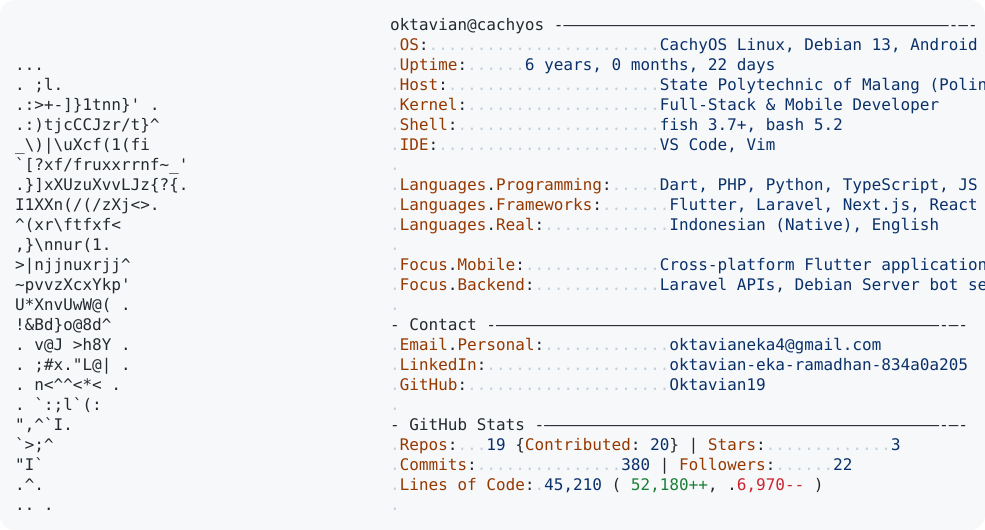

  <a href="https://github.com/Oktavian19/Oktavian19">
    <picture>
      <source media="(prefers-color-scheme: dark)" srcset="https://raw.githubusercontent.com/Oktavian19/Oktavian19/main/dark_mode.svg">
      
    </picture>
  </a>

  

    <a href="https://linkedin.com/in/oktavian-eka-ramadhan-834a0a205">LinkedIn</a> • 
    <a href="mailto:oktavianeka4@gmail.com">Email</a> • 
    <a href="https://github.com/Oktavian19">GitHub</a>
  

